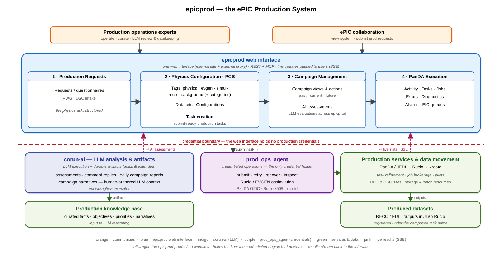
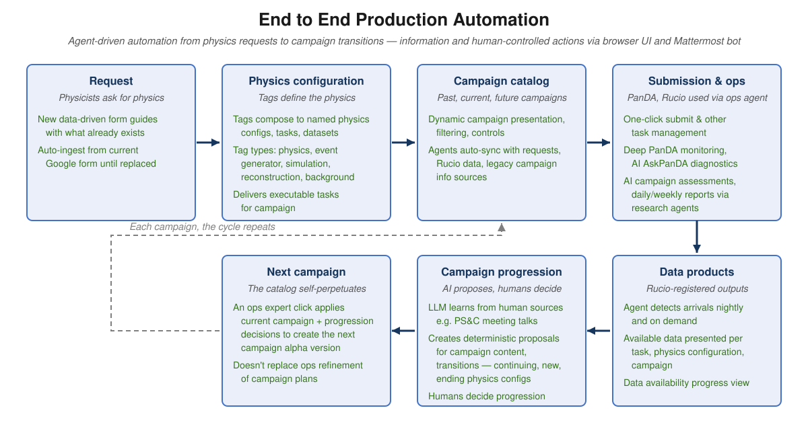
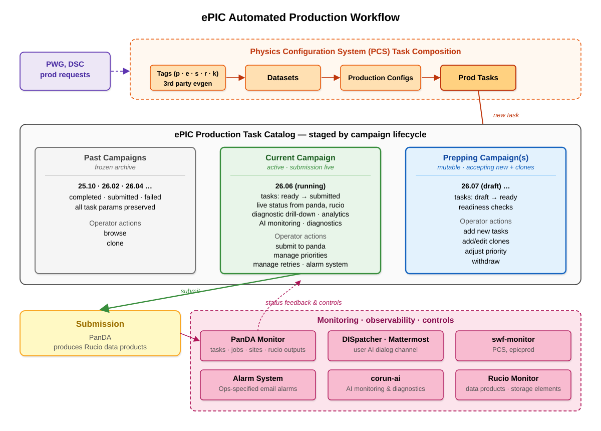
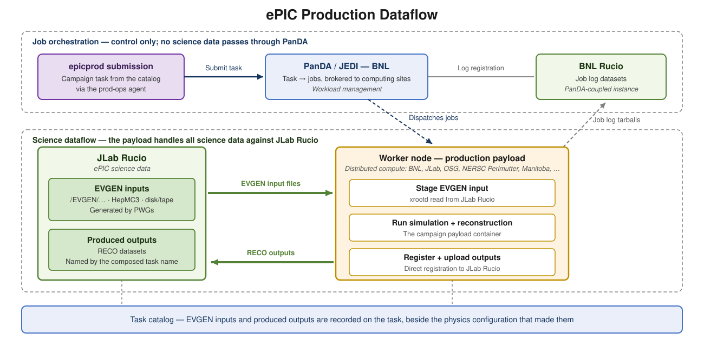
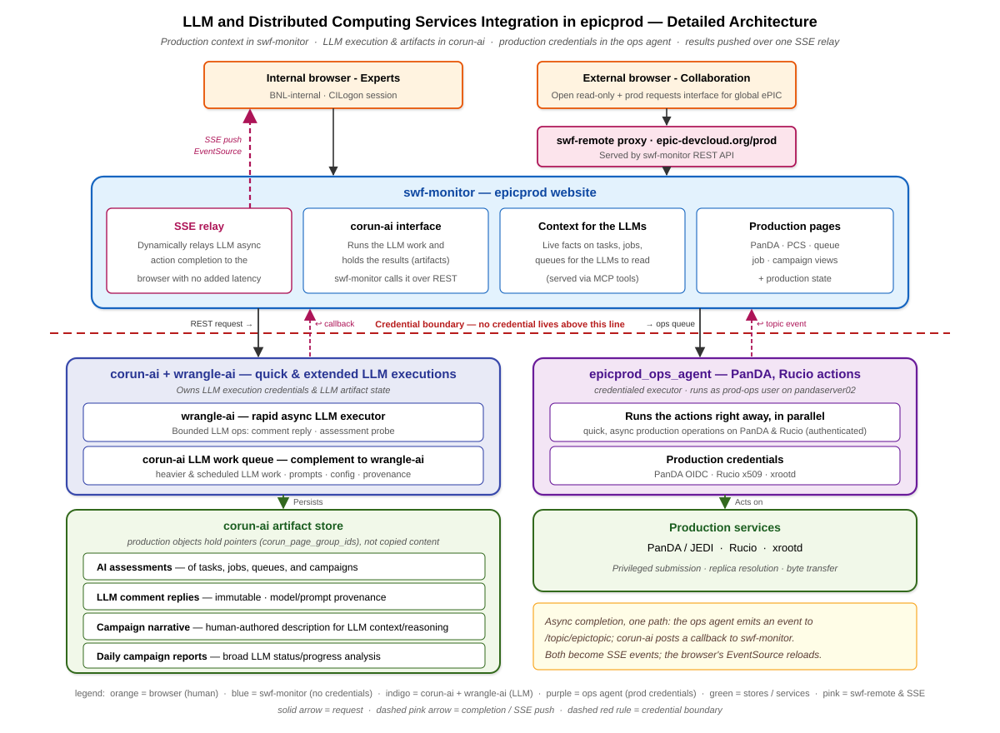

# Production System

This section documents epicprod, the ePIC automated production system: request intake, physics configuration,
campaign management, PanDA execution, data products, LLM assessments and reports, and the human controls and
curation that steer it.

## epicprod Overview

epicprod is the automated production system for ePIC simulation and reconstruction campaigns. It carries a
production request from community submission through physics configuration, campaign preparation, PanDA execution, and
cataloged data products, with AI assistance and human control points along the whole path. The operating principle set
in Foundations, maximal automation with minimal operations effort, shapes each stage: the routine mechanics are
automated, and people make the decisions. The implementation lives in the
[swf-monitor](https://github.com/BNLNPPS/swf-monitor) and
[swf-epicprod](https://github.com/BNLNPPS/swf-epicprod) repositories — production-specific components and
documentation are consolidating in swf-epicprod, running on the platform services of swf-monitor — whose
documentation carries the design and operational detail behind this section. The definitive current (June 2026) description of the system as deployed —
status, interface views, and near-term plans — is the S&C talk
[ePIC Production System: Status and Plans](https://docs.google.com/presentation/d/1Mhc5Isfq0dKOqYbf7fdFQvu7tM86gsKLYx542aYVL0U/edit).

The same path stage by stage — the automation each stage carries, and the human control points:

## Production Requests

Physics working groups and detector groups request production datasets through the collaboration's request form. PCS
mirrors each form response into a read-only questionnaire record, giving the collaboration a browsable view of all
requests and giving production records a single upstream reference for request provenance
([questionnaire design](https://github.com/BNLNPPS/swf-epicprod/blob/main/docs/EPICPROD_QUESTIONNAIRE.md)). The request
cycle follows the collaboration's monthly campaign rhythm: requests are coordinated through the physics working groups
and detector subsystem collaborations, validated by the production working group, and prioritized through the
collaboration's physics and technical coordination before the monthly production list is frozen for the campaign.

Triage turns submissions into structured production records. An operator links a response to one or more production
request records — one submission frequently spans several beam energies or Q² ranges — and composes each request from
PCS tags and a production configuration. A request is deliberately more abstract than an output: it specifies the
physics, beam energies, and kinematic range, and one request commonly leads to several produced datasets. Provenance is
by reference: a task resolves through its request to the originating submission, contact, and estimates without
duplicating them.

## Physics Configuration System (PCS)

PCS is the configuration layer of epicprod: the catalog of physics and processing definitions — tags, datasets,
sample variants, and production configs — from which production tasks are composed, with identity carried through
composed names. As the principal place where physicists meet the production system, it has its own section:
[Physics Configuration System](pcs.md).

## Campaign Management

Campaigns are time-ordered groupings of production tasks, named by year and month (25.10, 26.06). The production task
catalog is the instrument of campaign management: tasks composed from PCS configuration entities, carrying their full
parameter sets, staged by campaign lifecycle
([task catalog design](https://github.com/BNLNPPS/swf-epicprod/blob/main/docs/EPICPROD_TASK_CATALOG.md)).

Future campaigns are mutable: operators add new tasks and clones, adjust priorities, withdraw
entries, and move tasks from draft to ready under readiness checks. The current campaign is the live one: ready tasks
are submitted, and the catalog presents live status from PanDA and Rucio with diagnostic drill-down, analytics, and AI
monitoring. The last and past campaigns preserve all task parameters as the archive, and any campaign with data still
arriving keeps full active presentation as a producing campaign. Pre-PCS production has been
assimilated into past campaigns, making the catalog the complete ePIC production record.

The catalog stays complete by construction: a nightly sweep reads recent ePIC tasks from the PanDA task database,
associates them with their catalog entries, and assimilates any production submitted outside the catalog workflow —
creating the campaign, dataset, and task records with the physics classification derived from the task identity.
Tasks born in the catalog carry full configuration and request lineage; adopted tasks carry what assimilation can
derive, and the adopted count is a standing measure of migration onto the campaign-task flow.

Each campaign carries a human-authored campaign narrative recording its goals, priorities, and evolution. The narrative
gives operators and LLMs a shared context: daily campaign reports and assessments reason against it, and it accumulates
the campaign's history as decisions are made.

## PanDA Execution

Task submission is a catalog action: the composed task specification is submitted through the production operations
agent to PanDA, and each physical submission attempt is recorded on the task as a PanDA task association. The
submission mechanics, task naming of retries, and the science-data constraint that has production payloads stage EVGEN
inputs from and register outputs to JLab Rucio are described in Platform.

Live execution state flows back to the catalog and the ePIC PanDA monitoring views: task and job status, error
summaries, queue and site state, and resource usage. Payload logs are retrievable on demand from the task pages.

Experiment-specific behavior is supplied through ePIC-owned PanDA plugins:
the JEDI job throttler regulates generation, and the
[ePIC adder](https://github.com/BNLNPPS/swf-epicprod/blob/main/docs/EPIC_ADDER.md)
registers available outputs while excluding files marked absent or failed.
The adder preserves upstream registration errors and all job file records;
an optional log held in S3 does not become a zero-byte Rucio registration.
These plugins are installed from swf-epicprod and selected by configuration.
PanDA core changes go separately to its maintainers.

PCS allocates physical attempt names against both its complete association
history and PanDA's task names. Moving an old association to another PCS
task does not make that attempt's namespace available for reuse.

New task submissions also check their science-output namespace in JLab
Rucio and output/log namespace in BNL Rucio. An occupied name or an
unavailable catalog stops submission before dataset creation. Existing
PanDA tasks can still retry or resume using their own datasets.

The active pressure front automatically requests a pause when a production
task's latest ten counted completed attempts have all failed, or at least
25 of its latest 50 have failed, with the triggering failures spanning at
least three hosts. Worker losses, slot-time-limit kills and rejected worker
batch identities are set aside. The earlier threshold of at least 50
completed attempts with at least 95% failed remains active as a backstop
for queues with sparse host reporting. The operations agent verifies the
pause, and running jobs finish normally. An operator resumes the task after
repair; a verified resume starts a fresh failure sample. Shadow mode and
dry runs do not pause tasks. The counts, thresholds and operation are
retained on the live action stream. See the
[task failure guard](https://github.com/BNLNPPS/swf-epicprod/blob/main/docs/CONTINUOUS_PRODUCTION.md#task-failure-guard-23-october-2026).

The production watcher may also exclude an OSG glidein site whose
site-wide worker failures are established independently of task, input or
shared-service faults. This reversible protection updates future and
already-idle pilot matchmaking, preserves running work, and records its
evidence and verification. It is routine operations rather than an
operator decision request.

Operators steer execution with a graded set of task controls: native retries on an existing task (raising the
attempt budget, or restarting a finished task to retry its failures), pause and resume, stop-and-finish for work
not worth completing, priority changes, and reruns as fresh attempts — the entire task, or a residual rerun that
resubmits only the work units whose outputs never arrived, so delivered data is not regenerated. The retry paths
carry their own protections. Before a retry, the closed log datasets of a finished task are reopened: PanDA closes
them when a task ends, and the jobs of a bare retry would fail their log registration. A retry is vetoed when the
task's job sandbox is no longer in the server cache — every generated job would fail its first download — and
resubmission is recommended instead. A nightly pass keeps the sandboxes and log-dataset lifetimes of retryable
tasks alive through the retention window, and server-side retry rules bound the attempt cost of known futile
failure classes. The alarm system carries execution conditions that need attention. The mechanics are specified in
the [swf-epicprod JEDI integration document](https://github.com/BNLNPPS/swf-epicprod/blob/main/docs/JEDI_INTEGRATION.md).

Queue retirement closes admission; remaining work can be moved by a soft
reassignment while already-running jobs finish in place.
Production placement, queued submissions and site probes must agree on
that closure. Job generation, retries, pilot supply and shared capacity
accounting continue through the drain. A retired queue's stock must not
suppress generation for the active queue; an empty instantaneous job
queue does not mean the tasks are complete. The
[PROD_1 drain record](https://github.com/BNLNPPS/swf-epicprod/blob/main/docs/PROD_1_DRAIN.md)
documents the OSG implementation and its remaining work.

Placement also requires proof that the queue's pilots can run the task's
container image. The queue registry reads current image bindings from
the submit hosts' actual pilot templates, reported with their source and
hash. GREX selects the payload container per job; its bootstrap campaign
image does not restrict which edition it can serve. OSG pilots remain
bound to their glidein's image, with the allocator supplying multiple
image cohorts under one waiting-worker budget. A native pilot bound to
one image cannot serve another. The front
leaves such work unplaced with the required and served images in its
reason; manual placement, queued submission and the final submission
doer enforce the same rule. Missing or stale capability evidence refuses
placement rather than guessing. See
[pilot image compatibility](https://github.com/BNLNPPS/swf-epicprod/blob/main/docs/QUEUE_REGISTRY.md#pilot-image-compatibility).

## Data Products

Produced data are cataloged as the primary product of the system. Outputs are registered in JLab Rucio under the
composed task name: RECO reconstruction outputs and the associated log datasets. The catalog
gathers this lineage onto the task record, linking expected and observed outputs with their Rucio identifiers, status,
and access references, so a physicist can go from a physics configuration to its data products in one place.

Delivery is accounted over time as well as in totals. A nightly rebuild derives, from the Rucio record, a per-day
account of the files and data volume each physics configuration delivered; the campaign delivery view renders it as
the campaign's delivery history — the daily production yield an operator watches — alongside cumulative delivered
totals per configuration.

Third-party event-generation inputs are cataloged on the same footing. EVGEN datasets in JLab Rucio are swept into the
catalog and matched to the requests they serve, so a task's inputs and outputs are both visible beside the
configuration that consumes and produces them. On-the-fly event generation in the production payload is the planned
evolution of the input path, replacing staged inputs where generators support it, beginning with a Pythia8 proof of
concept.

## Event Service operation and commissioning

Google operates as a production Event Service site at five nodes, using the
common native ePIC pilot and the current 26.07.3 particle-gun configuration.
Its dedicated feeder keeps two finite 500,000-event tasks committed, with ten
50,000-event jobs per task, five-minute output closes and a two-hour harness
ceiling. The five-node controller cap permits at most 70 payload cores;
additional queued work does not expand it. PCS records each fresh sample's
disjoint seed reservation and normal retained RECO output. The feeder holds
on unknown, failed, paused or incomplete task state and checks storage and
image admission. The ordinary Google queue remains off. See
[Google production controls](https://github.com/BNLNPPS/swf-epicprod/blob/main/docs/GKE_PILOT_FLOW.md).

Perlmutter remains in Event Service commissioning; automatic production feeding
is disabled there. Its validation starts with a short 20-event, four-slot job
and a twenty-minute worker ceiling, then advances to production-shaped jobs
after successful execution and registered, readable outputs. The site's adapter
retains its Harvester identity and the existing Slurm submission path. See
[the Perlmutter runtime](https://github.com/BNLNPPS/swf-epicprod/blob/main/docs/NERSC_PERLMUTTER.md).

The NERSC allocation monitor still closes ordinary production at 90% CPU
allocation use. An explicitly commissioned queue remains operator-controlled:
the balance monitor neither closes it nor promotes it to production. Science
production requires completed debugging and validation, including ES output
usability and recovery behavior.

Particle-gun production is the preferred ES commissioning workload. It generates
events inside the workflow, so small whole tasks can contribute new production
statistics after validation. Each addition needs disjoint random streams and
recorded provenance: repeating the same stem and chunk indices reuses the gun's
seeds, even under another task name. Credit requires exact event coverage,
registered output and normal-reader validation. Reconstructing previously used
external EVGEN input adds no statistics and remains validation only. Google's
worker cap and Perlmutter's first-success gate remain in force.

On 25 October UTC, the native 26.07.3 gun gates passed on Google (41154)
and Perlmutter (41157): each finished and registered 20 events, and independent
PODIO readback found 20 unique event IDs, distinct generated truth, and all
387 collections readable. The authorized bounded production tasks are Google
41158 (`gES1`, 10,000 events, five-worker cap) and Perlmutter 41159 (`pES1`,
1,000 events, one job with a twenty-minute ceiling). Both reuse config 23's
neutron gun at 5 GeV and 3–50 degrees, with disjoint sample stems and recorded
generation plans. Initial Google production readback verified 56 events,
including the requested particle and angular range. Complete sample coverage
and natural worker-loss recovery remain separate checks; these bounded tasks
do not enable automatic feeding or expand either site.

Both complete samples subsequently passed independent readback: 10,000 Google
events in 15 files and 1,000 Perlmutter events in two files, with exact event-ID
coverage, no duplicates, distinct neutron truth at the requested angles, and
all 387 collections readable. Google also recovered a Spot-node shutdown:
19 registered events survived and a replacement job supplied the remaining
1,981, with complete final coverage. The exact cloud shutdown cause remains
unconfirmed. These output checks do not alter the physics-validation service's
verdict or authorize site expansion.

Task and job pages show per-core ES occupancy for both Google and Perlmutter,
including active jobs and their shipped harness snapshots. A running plot stops
at its observation timestamp and warns when stale. An ended job without a
normal harness end is shown as worker loss only when independent loss evidence
exists. Otherwise the plot identifies an incomplete observation; missing final
telemetry alone does not establish a failed interval.
Perlmutter's later task 41203 has not established sustained operation: its first
worker's last shipped record covers less than five minutes and only two events
were registered. Plot availability is separate from that production-validation
requirement.

Task 41215 subsequently ran 128 execution slots with initial processing starts
within 1.18 seconds and a recorded interval over 35 minutes. It did not pass the
saved-work requirement: only 32 events were registered; a 255-file close with
11,515 events was still running at the final observation. The pilot reported a
batch time limit, while the launch recorded exit 137 before its 45-minute
ceiling; the cause remains unconfirmed. A bounded fast-merge correction is
under commissioning, with independent PODIO checks before another site run.

Task 41218 (`pES4`) then ran the bounded fast-close configuration for 32 minutes
25 seconds with 128 slots and initial processing starts within 1.041 seconds.
All 27 closes completed, registering 52,332 events with no failed units.
Independent normal PODIO readback verified every saved event ID, 52,332 distinct
neutron truth records and all 387 collections. The allocation subsequently
completed normally. The per-core page shows aligned starts and saved processing
through the full run. Accounting remains unresolved: PanDA credits only the
first close's 208 events, despite the complete readable output. The task remains
paused to prevent duplicate reconstruction while those updates are reconciled.
This normal drain is separate from the controlled Google worker-loss test.

A controlled Google demonstration on 25 October used task 41207 (`gES3`),
30,000 fresh neutron-gun events and the normal five-minute rolling close.
After 30 minutes 5 seconds, the separately approved removal of one whole worker
pod left 17,482 events registered in six files. Independent normal PODIO readback
verified exact saved coverage, no duplicate IDs, distinct neutron truth and all
387 collections. Another 3,260 completed events were unshipped; 13 units with
1,688 assigned events were in flight. Normal closeout credited the saved work
and generated a replacement without a manual finish or range reset. That
replacement completed the remaining 12,518 events, recovering every unshipped
and interrupted assignment without overlap with credited work. PanDA credits
all 30,000 events. Independent complete readback of the 12 output files passed:
exact IDs 0–29,999, no duplicates, 30,000 distinct neutron truth records at the
requested angles and all 387 collections readable. The first worker's 14
payload slots were 96.3% occupied before the cut; occupancy includes unfinished
work and is separate from productive efficiency after the loss. See the
[Google worker-loss evidence and tools](https://github.com/BNLNPPS/swf-epicprod/blob/main/docs/GKE_PILOT_FLOW.md).

## Production Displays

The production dashboard and computing-centre room consume the same cached
[comp snapshot](https://github.com/BNLNPPS/swf-monitor/blob/infra/baseline-v46/docs/COMP_SNAPSHOT.md).
The feed owns operational counts, queue membership, health and notices,
including their wording, severity, details and drilldown links. It resolves
waiting-pilot counts from the submitter queue when reported, otherwise
Harvester, while retaining both raw readings for diagnosis. The displays
do not keep separate queue catalogues or compose separate fair-share notices.

Google uses the same production pillars, metrics and trend
presentation as GREX. A feed-owned display flag includes its active queue
while preserving inactive commissioning sites. Runtime and controller
diagnostics remain in operator views. Missing observations are unknown.
Canada, Perlmutter and JLab have the same standard panels while inactive;
panel availability is separate from operational activity. JLab's inworld
chart is placed above its Rucio board.
The Computing now, Work available and Campaign header blocks are also
formatted by the feed and consumed by both displays.

**Compute efficiency**, beside Site compute usage in the Sites menu and linked
from the Computing now heading, shows site heatmaps and monthly or weekly
trends. It measures finished-job core-hours divided by all ended-job core-hours,
including failed, closed and cancelled attempts; it excludes running jobs and
idle pilot time. OSG is split by execution site. Daily aggregates are retained,
refreshed hourly, and reconciled monthly; the current period is partial.
The dashboard panel below Storage shows monthly OSG, Perlmutter and GREX
curves for efficiency, total core-hours/day and productive average cores,
with overall last-24-hour readings and monthly averages since May.
Core-hours/day includes failed work; productive average cores divides
successful core-hours by elapsed hours. The three metrics use the same
ended-job sample without processor-performance weights. Current readings
refresh every minute; monthly rates use calendar time through the history's
observation timestamp, with the current month marked partial.
The incident comparison can exclude task 40856. See
[Compute efficiency history](https://github.com/BNLNPPS/swf-monitor/blob/infra/baseline-v46/docs/COMPUTE_EFFICIENCY.md).

Shared pure drawing modules supply the finished/failed proportions and
trend geometry, including hourly-rate conversion from the feed's bin
duration. Each display retains its own layout and drawing adapter. The
dashboard's running-job count and the room's running-core count keep their
respective units; one whole-node Event Service job can occupy several cores.
See the
[dashboard implementation](https://github.com/BNLNPPS/swf-monitor/blob/infra/baseline-v46/docs/PROD_DASHBOARD.md).

## AI Assistance

AI assistance appears throughout the production pages as durable, attributed artifacts. Assessments evaluate tasks,
jobs, queues, and campaigns and are attached to the objects they assess. Comment threads on production objects carry
discussion between operators, and an LLM participates in the thread on request. Daily campaign reports analyze status
and progress against the campaign narrative. Each artifact records its model and prompt provenance and is open to
comment, following the Architecture rule that AI outputs become artifacts in the system.

The assistance is delivered through the corun-ai and wrangle-ai services described in Platform: a page action requests
the LLM operation, and the result is pushed to the requesting page the moment it completes. A production bot provides a
conversational channel to the same system state for questions and diagnostics in chat.

### Detailed epicprod LLM Operations Architecture

The architecture of the LLM operations path — the production pages, the LLM services, the credentialed operations
agent, and the notification return — is diagrammed below.

## Human Controls and Curation

Canonical state changes by human hand. Lifecycle transitions — draft to ready, submission, lock, withdraw, retry and
recovery — are operator decisions exercised through catalog controls. Automation and AI may detect a condition, present
an interpretation, and surface the control that acts on it, and the human decides. Read access to the production pages
is open to the collaboration on both the internal and external faces; actions are gated by login and role, and
privileged execution stays behind the operations agent.

Curation is the human side of the automation bargain. Production experts maintain the campaign narratives, the curated
knowledge the LLMs reason from, and the priorities that steer the work; they review AI assessments and reports rather
than inherit them as fact. The system records these judgments — narratives, comments, decisions — so that the context
available to the next assessment, human or AI, keeps improving.
